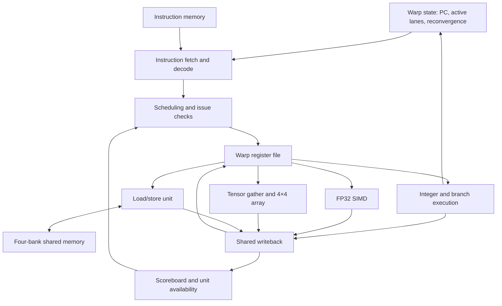
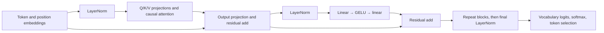

# Snackwell: building a snack-sized Blackwell compute architecture

**November 7 architecture update:** the first
[tensor-memory prototype](TENSOR_MEMORY.md) adds shared-memory matrix operands,
persistent FP32 accumulation, and completion tickets with consumer leases.
The [global-memory extension](GLOBAL_MEMORY.md) now adds kernel-issued external
loads/stores and a checked global/shared/tensor/global matrix kernel. The
measurements and architectural baseline below predate both extensions; their
contracts and tests are documented separately. NVFP4, asynchronous tile copies,
and a new physical fit are still pending at that milestone.

**November 9 update:** [asynchronous tile copies](ASYNC_COPY.md) now protect
shared staging with completion tickets and consumer leases. A three-tile matrix
kernel takes 1,412 cycles with double buffering versus 1,582 with serial copies
under the same memory timing, with exact FP32 output and full memory guards
checked. The cooperative tests also exposed and corrected scheduler starvation
on repeated resource stalls. The historical measurements below remain unchanged.

**November 9 NVFP4 update:** [packed NVFP4 matrix operations](NVFP4.md) now run
through global memory, shared staging, narrow-product hardware and FP32 tensor
accumulation. The checked 4×32 by 32×8 demo uses two scale groups and two output
tiles, taking 1,656 cycles with overlapping copies versus 2,350 serially.
A first-block query-projection slice from checkpoint `43f211daad7c` matches
the quantized reference exactly; its relative L2 error versus the original
FP32 calculation is 9.18%. This is an operation-level quantization measurement,
not evidence of full-model answer quality or an FPGA result.

**November 9 model integration:** [opt-in NVFP4 inference](NVFP4_INFERENCE.md)
now executes all transformer linear projections on the native packed path,
with FP32 attention and nonlinear kernels. Independent whole-model checks
match bit for bit. Eight sampled reserved sentence questions retain correct
answers in both modes; the character model changes two of eight paired next
predictions. FP32 remains the default. These model launches still use host
shared-memory transfers in that experiment; FPGA fit remains unverified.

**November 9 global model update:** [external-memory inference](GLOBAL_MODEL.md)
now runs every kernel's data transfers through the SM's global port, using
asynchronous shared staging for NVFP4 tiles. Eight reserved sentence questions
produce identical probabilities and tokens across 56 predictions in both memory
modes. The host still orchestrates launches and retains checkpoint/KV state;
persistent device allocation and physical memory integration remain.

**Satvik Garimella · Engineering report · Updated November 9, 2026**

Implementation baseline: [`f865889`](https://github.com/satvikgarimella/Snackwell/commit/f865889ed9118fa0effc902c3e2534c656095fb6).
Measurements below identify their own experiments; they were not all collected at this revision.

## Abstract

I started Snackwell to build a small, inspectable implementation of Blackwell's
compute architecture and run programs through it. This report describes the
implemented foundation and its measurements; the
[Blackwell alignment plan](BLACKWELL_ALIGNMENT.md) specifies the architectural
work still required. The project includes a SystemVerilog streaming multiprocessor, a custom
instruction set, a Python assembler, numerical kernels, and a runtime that
executes transformer inference and training in RTL simulation. Its four-warp,
four-lane SM combines integer execution, FP32 arithmetic, a 4×4 systolic array,
and 4 KiB of shared memory.

The main engineering work was making these components work together: retaining
dependencies across multi-cycle execution, handling memory conflicts, mapping
larger matrices onto small tiles, and moving model state through limited memory.
Performance work reduced both simulated execution cycles and simulator overhead,
with independent numerical checks retained throughout.

Full transformer forward passes, backward passes, and SGD updates have been
verified on the RTL. A separate compact model, trained in host PyTorch, answers
two-fact location questions through the same RTL inference path. It answers
6,244 of 6,272 supported prompts correctly in exhaustive host evaluation; 18
selected RTL answer checks passed. The complete device has also been synthesized
and tested as a netlist. Physical FPGA fit, timing closure, and board execution
remain open.

## 1. Project scope

The goal is a scaled-down Blackwell compute design whose behavior I can trace
from an assembly instruction to a register write, then use for complete numerical workloads.
That required more than a matrix multiplier: programs also need scheduling,
branches, memory, dependency tracking, and a way to launch and inspect work.

Snackwell currently implements one SM. A **warp** is a group of four lanes
executing an instruction together; each lane has its own register values.
Four warps can remain resident, allowing the scheduler to select other eligible
work when an instruction cannot proceed.

| Component | Implemented configuration |
| --- | --- |
| Execution | Four resident warps, four SIMD lanes per warp |
| Registers | 16 × 32-bit registers per lane per warp; 1 KiB total |
| Instructions | Custom 32-bit ISA; 1,024-word program memory |
| Scalar/vector arithmetic | Integer ALU and four-lane FP32 multiply/add/subtract |
| Tensor execution | One shared 4×4 array with 16 FP32 processing elements |
| Shared memory | 4 KiB, divided into four banks |
| Control | Warp scheduling, active masks, divergence/reconvergence, scoreboarding |
| Software | Assembler, kernel generators, launch runtime, independent references |
| Hardware endpoint | Program/data loading, launch, status, and readback bus |

At this report's baseline, the system had no global-memory controller, DMA engine,
cache hierarchy, or cooperating-warp barrier. The model runtime still stores weights and persistent state on the host,
and transfers working data between bounded launches. The public hardware bus is
verified in simulation; a physical board connection is still required.

The confirmed reference is B200 / datacenter Blackwell SM100. Legacy `TMUL`
uses register operands and writes a fresh FP32 product back to registers.
At the report baseline, dedicated tensor-memory access, explicit matrix completion
synchronization, and block-scaled tensor arithmetic were architectural gaps.
The first two now have the reduced prototype described above; block-scaled
arithmetic remains open. The alignment plan distinguishes these changes from
deliberate reductions in lane count, tile size, and storage capacity. One-PC-per-warp
control is a further behavioral simplification: the initial proposed subset
uses uniform cooperating warps and does not implement independent-thread scheduling.

## 2. Following an instruction through the SM

The diagram shows the main responsibilities and connections, rather than a
fixed number of pipeline stages.



Fetch and decode identify an operation and its operands. Issue checks then
determine whether its sources are available, its destination is free, and its
execution unit can accept work. The register file supplies operands from the
selected warp. Results return through a shared writeback path.

For a dependency such as:

```text
FMUL R3, R1, R2
FADD R4, R3, R5
EXIT
```

the add must wait until the multiply has actually committed R3. Reserving a
destination only until arithmetic finishes would be insufficient: the result
may still be waiting for writeback. The scoreboard tracks read-after-write and
write-after-write hazards per warp and register. It conservatively reserves
the whole register even when only some lanes are active.

An accepted FP operation retains its warp ID, destination register, and active
mask. This matters when control flow changes the warp's mask before completion:
the result must still update the lanes that issued it. Operands are captured
at acceptance, so later source-register changes cannot alter an operation
already running.

When lanes disagree on a branch, the warp executes paths under different active
masks and later rejoins them at a reconvergence point. The reconvergence stack
retains pending control-flow state and masks. Separating that state from the
tags on accepted operations allows an older result to complete correctly while
the warp moves through another path.

The SIMD FP unit accepts one outstanding instruction globally. Its scalar
units finish within four clocks after acceptance, sometimes earlier for
special cases; collection and writeback take additional cycles. Independent
integer, memory, or control work can continue when its resources are available.
These are bounded-latency units, with no claim of accepting a new FP instruction
every clock.

Competing completions use the priority FP result, tensor row, shared-memory
load, then newly issued integer result. Waiting producers retain their data.
`EXIT` waits for pending writes and memory requests, including stores. The
implementation and edge cases are documented in [FP32 execution](FP32.md).

### Shared-memory conflicts

A bank cannot service arbitrary different words for every lane simultaneously.
The memory unit snapshots the request and services conflicting accesses over
additional cycles. Read-only accesses to the same word can broadcast a single
bank result to multiple lanes. Requests containing stores preserve ascending
lane service order, including when addresses alias.

This turns conflict detection into a complete execution mechanism: every
accepted lane request is accounted for before completion. The unit currently
supports one outstanding request. Its contract and tests are in
[shared memory](MEMORY.md).

## 3. The systolic array and its numerical contract

The tensor unit computes a fresh 4×4 product, `C = A × B`. Each processing
element owns one output element and contains a multiplier, an adder, and an
accumulator. A operands travel right, B operands travel down, and partial sums
remain in their processing elements.

For output position `(i, j)`, four products are accumulated in increasing
inner-dimension order:

```text
C[i,j] = +0
for k = 0, 1, 2, 3:
    product = round_binary32(A[i,k] * B[k,j])
    C[i,j] = round_binary32(C[i,j] + product)
```

Multiplication and addition round separately. A fused multiply-add reference
can therefore disagree even when both implementations are behaving correctly.
Snackwell uses nearest-even rounding and handles signed zero, subnormals,
infinities, and NaNs. It does not implement selectable rounding modes or FP
exception flags.

Inputs enter at staggered times so each cell receives matching operands. Cell
`(i, j)` processes inner index `k` at logical transport step `i + j + k`.
Sixteen cells perform four multiply-accumulates each, giving 64 MACs across ten
logical steps. These steps each span multiple clocks.

The current controller advances operands after valid products have reached
their adders. The next multiplication can overlap the preceding addition;
products wait when necessary, and additions retain their order. After the last
transport step, pending additions drain before the result becomes visible.
This is more concurrent than the original implementation, which waited longer
between operand movements.

### Connecting the array to instructions

```text
TMUL R8, R0, R4
```

Here R0–R3 hold A, R4–R7 hold B, and R8–R11 receive C. A register holds a
matrix row, with its four lanes holding the four columns. The SM gathers one
row of each input per clock for four clocks, owning both register read ports
during that interval. Instruction issue pauses during the gather; independent
work can resume once the inputs have been captured.

The adapter passes complete tiles directly to the array and writes C back one
row at a time. All four destination registers remain reserved until the last
row commits, so a consumer cannot observe a partly written tile. Input/output
register ranges may overlap because input gathering finishes before writeback.

The issue-time lane mask controls output columns. All input lanes are still
read: an active C column can depend on every input column. This distinction is
covered by full-SM tests. See [tensor execution](TENSOR.md) for the interface,
operand alignment, and reservation rules.

## 4. From assembly to kernels

A kernel is a program for the SM that performs a particular operation over
data. Snackwell kernels use its own assembly ISA. The Python assembler encodes
instructions into machine words, replacing manually packed testbench programs.
Python also generates repeated instruction sequences and memory layouts for
different tensor shapes.

The kernel library grew from vector operations and matrix multiplication to
reductions, linear layers, LayerNorm, GELU, softmax, attention, and transformer
forward/backward operations. Exponential, reciprocal, reciprocal-square-root,
and logarithm computations use approximations built from existing instructions.
Their error is checked against independent numerical references; there is no
dedicated hardware instruction for every model operation.

Larger matrix multiplication reuses the same 4×4 hardware. An 8×8 product has
four output tiles, each requiring two inner-dimension tiles: eight `TMUL`
operations, plus data movement and accumulation. The runtime partitions larger
problems further to fit program and shared-memory limits.

Tiled matmul can assign disjoint output tiles to up to four warps. One warp can
load operands or accumulate a previous result while another uses the shared
tensor unit. Giving each output tile one owner avoids cross-warp
producer/consumer dependencies and therefore does not require a barrier.
There is still only one tensor array.

Preserving the accumulation order was a constraint on optimization. Reordering
FP32 sums can change output bits, so the paired performance experiments retain
the original grouping and validate architectural outputs. The kernel design
is described in [the kernel guide](INFERENCE_KERNELS.md) and
[matrix multiplication](MATMUL.md).

## 5. Executing a transformer

The model runtime composes these kernels into a causal transformer with learned
token and absolute-position embeddings, pre-normalized attention and MLP
blocks, residual connections, final normalization, and a vocabulary projection.



For one attention head, the mathematical operation is:

$$
Q=XW_Q,\quad K=XW_K,\quad V=XW_V,
\qquad
\operatorname{Attention}(X)=
\operatorname{softmax}\!\left(\frac{QK^T}{\sqrt{d_h}}+M\right)V,
$$

where the causal mask `M` excludes future positions. The executed kernels use
the project's specified FP32 ordering and numerical approximations.

### The host/RTL boundary

| Responsibility | Where it executes |
| --- | --- |
| Read checkpoints, tokenize text, choose memory layouts | Python host |
| Hold complete weights, persistent tensors, and cached K/V | Host memory |
| Assemble, launch, and move raw input/output words | Host runtime |
| Embeddings, matrix products, normalization, activations, attention | SM RTL |
| Probability calculation and token selection | SM RTL |
| Supply a seeded random scalar for sampled decoding | Host; selection still occurs in RTL |
| Compute independent references and compare results | Host verification |

The 4 KiB shared memory is working storage, not storage for the complete model.
The host copies actual RTL output words into subsequent launches. Independently
computed reference activations are never substituted into the executed model.
The Verilator C++ driver clocks the circuit and transports raw words; it does
no model arithmetic.

This arrangement demonstrates the arithmetic and control path through the SM.
It also explains why the current demonstration still depends heavily on the
host and does not establish autonomous FPGA inference.

## 6. Prefill, cached decode, and performance

**Prefill** processes the prompt and saves each layer's actual keys and values.
**Decode** computes the new token's activations, attending to saved K/V and the
new entry. A KV cache removes repeated work on earlier tokens; weight movement,
new projections, attention, launch overhead, and verification still cost time.

Learned absolute positions complicate overflow. Shifting old tokens to new
positions while retaining their K/V would reuse states computed for different
inputs. The general runner instead rebuilds the newest three quarters of the
context at positions starting from zero. For a 32-token context, it retains 24
tokens. The compact sentence demo rejects context overflow so facts are not
silently discarded.

Cached and fresh execution are compared on the same active prefix and context
policy. They need not match the earlier sliding-window policy. Cache identity
includes the prefix, model configuration/weights/tokenizer, and RTL fingerprint;
updates commit only after successful checks. The independent reference maintains
its own double-precision state. See [KV caching](KV_CACHE.md).

One-row decode also has a different shape from multirow prefill. A SIMD
matrix-vector path avoids filling a 4×4 tensor tile with mostly padded rows,
while multirow products continue using tensor tiles. This preserves the
required summation grouping; the change is documented in
[the inference repair](INFERENCE_REPAIR.md).

### Controlled measurements

The following are separate paired experiments on the development Mac. Each
retained numerical verification. Compilation is excluded. The rows use
different revisions and workloads, so their speedups must not be multiplied.

| Experiment | Paired result | What changed |
| --- | --- | --- |
| Bounded FP32 arithmetic and tensor transfers | First forward pass: 22.44 → 11.21 s; 32,235,401 → 11,847,367 cycles | Shorter FP arithmetic, overlapping multiply/add, direct tile transfer |
| Multiwarp kernels and runtime | First forward pass: 10.3903 → 8.0139 s; 11,847,367 → 8,101,875 cycles | Tile ownership across warps, broadcast loads, bias fusion |
| KV cache against recomputing the same context | 16 characters: 118.12 → 46.11 s; 117,891,652 → 38,060,603 cycles | Reuse K/V between periodic rebuilds |
| Earlier one-row decode optimization | Cached output: 1.93 → 1.20 s/character | Less row transport, combined Q/K/V launches, cached reference work |
| Binary simulator transport, default character model | Cached output: 0.68 → 0.34 s/character | Remove repeated file transport; identical simulated cycles |

The first two experiments use checkpoint `43f211daad7c`, the same prompt
`My lord, I have something to say`, and matched sampling settings. The KV-cache
experiment compares identical active contexts and reports rebuild costs. The
one-row experiment used before/after/after/before ordering. The transport
experiment used `ROMEO:`, four generated tokens, and full/summary/summary/full
artifact modes. Its timings exclude checkpoint loading as well as compilation.
The earlier one-row experiment still used padded tensor tiles; the SIMD matvec
path was a later change.
Full methods and records are in [FP32 speed](FP32_SPEED.md),
[runtime speed](RUNTIME_SPEED.md), [cache verification](KV_CACHE.md),
[decode optimization](DECODE_OPTIMIZATION.md), and
[transport measurements](measurements/inference-transport.json).

A representative 64-`TMUL` projection chunk helps explain the multiwarp result:

| Trace metric | Previous kernel | Multiwarp kernel with bias |
| --- | ---: | ---: |
| Total cycles | 9,283 | 5,865 |
| No eligible warp | 6,457 | 62 |
| Tensor adapter idle | 3,779 | 361 |
| Array compute | 4,864 | 4,864 |

The arithmetic work stayed constant, while scheduling left the tensor unit idle
less often. These counters describe overlapping conditions and cannot be added
as a breakdown of total time. Matrix operations accounted for about 71% of
simulated cycles in one recorded decode step; that is not a measurement of
71% wall-clock time stalled on matmul.

First-output latency includes prefill and selection. Subsequent-token averages
can include context rebuilds; a cached-decode average excludes those rebuilds.
All timings here are verified simulation measurements, not FPGA throughput.
Reducing simulator file I/O improves wall time without making the circuit
execute fewer cycles.

## 7. Full transformer training on the RTL

Training adds the loss, backward pass, parameter gradients, and optimizer
updates to inference. Snackwell implements these as kernels, including
attention, softmax, LayerNorm, GELU, residual, and embedding gradients.

For a linear layer `Y = XW + b`, the backward operations are:

$$
\frac{\partial L}{\partial W}=X^T\frac{\partial L}{\partial Y},
\qquad
\frac{\partial L}{\partial X}=\frac{\partial L}{\partial Y}W^T,
\qquad
\frac{\partial L}{\partial b}=\sum_{\mathrm{rows}}\frac{\partial L}{\partial Y}.
$$

The mean cross-entropy logit gradient is `(p − one_hot(target)) / T` for `T`
target positions. Loss evaluation uses a stable log-sum-exp formulation, with
the logarithm approximated by existing instructions. Gradients use pre-update
weights. SGD then performs a separately rounded FP32 multiplication and
subtraction: `weight = weight − learning_rate × gradient`.

Two experiments establish different properties.

### Learning from random initialization

The October 21 audit trained a one-block, two-head, width-16 transformer with a
16-character context and 4,657 parameters. It executed 100 RTL SGD steps at
learning rate 0.05. The same 32 windows per split were evaluated before and
after, giving 512 sampled target positions per split.

| Mean cross-entropy | Before | After |
| --- | ---: | ---: |
| Training sample | 4.688200 | 3.414652 |
| Validation sample | 4.638922 | 3.491582 |

All forward/backward/update checks passed. Including evaluations, the run used
132,994,946 cycles and 37,365 launches. Validation loss fell by 24.73% on this
sample, demonstrating learning from the training data. This short experiment
does not establish fluent text generation.

### Checking every gradient in a larger model

A separate audit used the four-block, four-head, width-128 subword model:
context 64, vocabulary 512, and 669,952 parameters. Its initial pretraining ran
in host PyTorch with AdamW. The audit then executed two full SGD updates on
Snackwell; the second resumed the saved checkpoint from the first.

Every parameter gradient was compared directly with float64 PyTorch autograd.
The largest absolute errors were `9.25e-7` and `3.62e-7`. Every updated FP32
word matched independent multiply/subtract calculations using the RTL gradient,
and updates were also compared against independently computed gradients.

The reference loss on each update's own batch decreased from 2.180006 to
2.161469 and from 3.080021 to 3.039702. These are different batches. The small
held-out change after two updates does not establish a meaningful improvement
in language quality.

The [training audit](TRAINING_AUDIT.md) documents the checks. Portable copies of
the [learning result](measurements/report-20261105/transformer-learning.json)
and [gradient audit](measurements/report-20261105/transformer-gradient-audit.json)
preserve the measured values. Their runs overlapped, so their wall times are
not presented as isolated training benchmarks.

## 8. Language quality and the compact demonstration

Early character generation repeatedly produced fragments such as “the”. The
independent host model produced the same behavior, which helped separate
language-model limitations from incorrect hardware execution. Sampling changed
the continuations but did not make the model reliably coherent.

Wider models, longer contexts, subword tokenization, and additional training
improved some held-out losses while retaining grammar and context errors.
Larger models also increased execution cost. Token healing repaired trailing
space and partial-token prompt boundaries; optional probability filtering
changed sampling. Neither established a language-quality fix. Pretrained
candidates were screened on the host, but none became a completed pretrained
Snackwell runtime. The failed examples remain in the
[quality](QUALITY_REPAIR.md) and [decoding](DECODING_REPAIR.md) records.

I then narrowed the target to a compact task with an explicit answer and a
finite test space: read two location facts and generate a sentence answering
a question about one object.

```text
The toy is in the hallway. The ball is in the kitchen. Where is the ball?
Answer: The ball is in the kitchen.
```

The grammar supports eight objects and eight places, with two distinct objects
in different places. The input validator checks that scope; it does not look
up an answer. The transformer generates answer tokens using unfiltered greedy
selection in RTL.

The selected model has four blocks, two heads, width 32, a 32-subword-token
context, vocabulary 97, and 41,569 FP32 parameters. Its raw weights occupy
166,276 bytes. **This checkpoint was trained in host PyTorch**, separately from
the verified RTL training experiments above.

Training used 3,552 two-fact examples, with 576 validation and 576 reserved test
examples. Complete object/location associations were reserved: neither fact in
a training example contains a reserved pair. The tokenizer was fitted on
training text only. Training supervises answer tokens, masks prompt/padding
loss, and uses a curriculum with additional training-only single-fact scenes.
Validation loss selected the checkpoint.

| Evaluation | Result | Execution |
| --- | ---: | --- |
| Validation questions | 576 / 576 exact answers | Autonomous host generation |
| Reserved test questions | 576 / 576 exact answers | Autonomous host generation |
| Entire supported grammar | 6,244 / 6,272; 99.55% | Autonomous host generation |
| Selected hardware answer checks | 18 / 18 | Verified RTL inference |

There are still 28 wrong answers, often caused by selecting the other object's
location. The exhaustive count includes training examples and was reused during
development after the first audit. It is a finite-domain regression result,
not an untouched estimate of general language ability. Reserved pairs never
entered gradient training. The 6,272 host cases were not all executed in RTL.

In the terminal example above, seven generated tokens required 3,608,046
simulated cycles and 1,135 launches. With Verilator already compiled, the answer
took 9.13 seconds including verification: 4.54 seconds to the first token and
0.76 seconds per cached token afterward, without a rebuild.

The [task specification and training recipe](SENTENCE_DEMO.md),
[complete host results](measurements/sentence-completion-20261028/host.json),
[remaining errors](measurements/sentence-completion-20261028/remaining-errors.json),
[RTL checks](measurements/sentence-completion-20261028/rtl.json), and
[terminal record](measurements/sentence-completion-20261028/terminal.json)
make both the successful cases and the remaining failures inspectable.

## 9. Verification strategy

Verification proceeds from arithmetic and interfaces to complete workloads.
RTL benches cover FP edge cases, dependency tracking, masks, divergent control
flow, memory conflicts, tensor alignment, backpressure, resets, and completion.
Kernel checks compare outputs with independent numerical calculations and check
memory guards. Whole-model checks compare intermediate tensors and final
probabilities from the original inputs and weights.

Bitwise equality is used where identical FP32 computation is expected, such as
paired scheduling/transport changes and SGD update words. Comparisons with
higher-precision references use documented tolerances. Training additionally
uses finite differences and independent autograd. Fault-injection tests check
that deliberately corrupted backward results are rejected.

The November 5 validation passed 39 RTL testbenches and 185 Python test methods
in aggregate. The initial full invocation passed the RTL benches and completed
181 Python methods, but failed the HTTP test class setup because the sandbox
blocked localhost binding. A separate retry with loopback access passed all four
HTTP methods. Ruff lint/format checks and 36 assembly-example checks also passed.

This was not one uninterrupted green invocation. The
[validation archive](measurements/report-20261105/README.md) retains the initial
failure log, original result, combined summary, and provenance. No tests were
rerun merely to produce this report.

## 10. Synthesis and FPGA feasibility

Yosys synthesized the full `snackwell_device`, including the SM, memories,
execution units, and host bus. Both the generic gate netlist and preliminary
Cyclone V primitive netlist passed protocol tests and four numerical kernels.
Netlist simulation matched the original RTL's complete memory results and
execution cycles: vector add 73, vector multiply 73, tensor matmul 136, and
SIMD matmul 303. These counts exclude loading and readback.

These tests check the exercised netlist behavior. They do not establish formal
equivalence or physical timing. The source set and hashes in the
synthesis report still matched the current RTL at the November 5 audit.

| Preliminary Cyclone V primitive | Count |
| --- | ---: |
| 27×27 DSP multipliers | 20 |
| Flip-flops | 20,697 |
| Logic ALUTs | 37,730 |
| Arithmetic ALUTs | 6,234 |
| One-bit MLAB memory slices | 3,072 |
| M10K blocks | 0 |

The provisional board is a DE1-SoC with a `5CSEMA5F31C6`; the physical board
model still needs confirmation. Its capacity is 32,070 ALMs, 128,300 registers,
87 DSP blocks, and 397 M10Ks. An ALUT count cannot be compared directly with an
ALM count. Similarly, one-bit MLAB slices are not complete physical MLABs.

The [resource audit](measurements/fpga-fit-20261105/README.md) estimates an
optimistic 27,241 ALMs, or 84.94% of the device, after hypothetical packing.
It assumes favorable logic/register sharing and omits routing, control-set,
clock, and integration costs. The MLAB accounting groups the slices into 192
physical MLABs. **This arithmetic does not establish that the design fits.**
Quartus can map differently, and only the fitter can determine a legal layout.

Memory capacity requires a separate check. The sentence model's weights plus
full-context K/V need 199,044 bytes, below the device's 508,160 raw M10K bytes.
That excludes activations, padding/replication, controllers, and training state.
Those model/KV memories are also absent from the current core netlist: the SM
still exposes only 4 KiB of data memory. Raw capacity is therefore not evidence
of an integrated implementation.

The prepared Quartus fit script targets the complete core with virtual bus
pins and a proposed 50 MHz clock constraint. It runs mapping, fitting, and
timing analysis; vendor execution remains unverified. The core-only flow does
not include the board transport or generate a deployable bitstream. The
[synthesis report](SYNTHESIS.md) and
[recorded mapping](../fpga/reports/yosys-cyclonev-20261021.json) preserve the
current evidence.

## 11. Remaining work and engineering lessons

The next architectural step is to specify and implement the reduced
tensor-memory and matrix-accumulation interface, including shared-memory operand
descriptors and completion/visibility rules. Device data movement and a
documented block-scaled arithmetic path follow. Legacy `TMUL` keeps its existing
numerical contract; the new path needs separate rounding and ordering checks. The
[alignment plan](BLACKWELL_ALIGNMENT.md) gives an implementation order and the
evidence each step needs. These extensions are not covered by the existing
inference, training, or synthesis results.

The next hardware milestone is a real Quartus fit and timing report on the
confirmed device for the current core. That baseline should guide changes to memory inference,
FP32 resources, and control logic. Physical deployment then needs clock/reset
integration, transport, pin assignments, I/O constraints, and a way to supply
model data. The first board checks should repeat the vector and matrix kernels
before connecting the complete inference runtime.
The extended Blackwell-oriented design will require a new fit and timing check.

Kernel work remains useful alongside deployment: reduce transfers and launch
count, improve reuse, and measure resource stalls on representative shapes.
A memory hierarchy and barriers would support kernels that exchange data
across warps.
The compact language task still has known answer errors; larger training runs
and model-quality claims need their own evaluations.

Several lessons emerged from the work. The systolic array's arithmetic speed
only helps when operands arrive and completed tiles can leave. Multiwarp
scheduling improved utilization without adding an array. Decode required a
different kernel shape from prefill. A cache required a defined position and
overflow policy. Faster simulation needed attention to host overhead as well
as RTL cycles. Finally, matching a numerical reference establishes execution
correctness; producing useful answers and fitting on a physical device require
separate evidence.

## Appendix: reproduce and inspect

Run commands from the repository root. Basic kernels require Python 3.10+ and
Icarus Verilog. Verilator, a C++ compiler, and `make` provide the faster model
simulation path. Full optional training/reference tests and host quality
evaluation require PyTorch; the local environment used for these checks is
`build/model-venv`. Dataset and synthesis setup are documented in the linked
guides. These commands rerun checks; exact wall times depend on the machine.

```sh
# Unit and integration regressions, including optional PyTorch checks.
build/model-venv/bin/python scripts/run_tests.py

# Small kernels and tensor/SIMD comparison.
python3 scripts/run_kernel.py vector_add
python3 scripts/run_kernel.py matmul_compare

# Current bounded sentence demonstration.
python3 scripts/run_sentence.py --interactive

# Reproduce the small full-transformer training experiment.
python3 scripts/train_transformer.py \
  --steps 100 --evaluation-windows 32 --log-every 10 --simulator verilator

# Check the public device bus and synthesize/test the mapped netlist.
python3 scripts/check_fpga.py
python3 scripts/synthesize.py --target cyclonev --verify

# On Windows/Linux with Quartus and Cyclone V support installed.
quartus_sh -t fpga/de1_soc/run_fit.tcl
```

The training command requires the local TinyShakespeare dataset, or `--data`
pointing to it. It saves a new checkpoint; it does not replace the sentence
model. The sentence evaluation and host-training reproduction commands are
in [SENTENCE_DEMO.md](SENTENCE_DEMO.md).

| Implementation or evidence | Entry point |
| --- | --- |
| SM issue, hazards, execution, writeback | [multiwarp_execution_core.sv](../rtl/sm/multiwarp_execution_core.sv) |
| Tensor instruction integration | [sm_tensor_unit.sv](../rtl/sm/sm_tensor_unit.sv) |
| Array and processing elements | [tensor RTL](../rtl/execution/tensor/) |
| Shared-memory service | [shared_memory.sv](../rtl/memory/shared_memory.sv) |
| Model launches and data movement | [model_runtime.py](../snackwell/model_runtime.py) |
| Model kernel generation | [model.py](../snackwell/kernels/model.py) |
| Public FPGA endpoint | [snackwell_device.sv](../rtl/fpga/snackwell_device.sv) |
| Training and current validation records | [portable audit archive](measurements/report-20261105/README.md) |
| Sentence checkpoint and task evidence | [task guide](SENTENCE_DEMO.md) |
| FPGA fit assumptions and source checks | [resource audit](measurements/fpga-fit-20261105/resource-audit.json) |

The sentence checkpoint is identified by SHA256
`66af3342b4a66ee4e63816f30756f3aed746b749b300ecd6f13c324be0d2423e`.
Individual records retain their own checkpoint and simulator fingerprints so
historical performance and correctness results remain tied to what ran.
